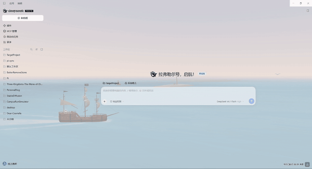
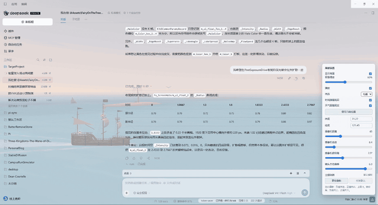

English · [简体中文](README.md)

# dsh-ocean-background

Draws a daytime ocean behind the whole DSH window. What happens on screen mirrors the work in progress: the main agent is a pirate ship under way, every subagent is a row boat of its own, the canvas state shows whether a boat is working, and the swell follows token throughput.

## Preview

**Home.** The main agent's ship sails across the ocean while the bottom right corner counts the miles sailed today.



**Day, night and weather.** The sky walks from daylight into dusk and overcast while the water shifts with it.



## The scene

- **Main ship.** The main agent of the current session, always sailing to the right with the camera following horizontally. Full canvas while working, part of it furled while idle or waiting for input.
- **Row boats.** One per subagent, including grandchildren and deeper levels. A boat enters from the left when its work starts and exits to the right when it completes, fails or is cancelled. The light rocking of the oars shows activity; boats do not mirror the main ship's canvas.
- **Swell.** Driven by token throughput across input, output, cache write and cache read increments, sampled once per second and exponentially smoothed into wave height. Cost plays no part. Even when idle there is a wide, slow roll, and high throughput brings whitecaps.
- **Wind and scenery.** Up to two wind lines across the screen, with sandbars, green islands, rocky islands, reefs and the occasional seabird along the way. Scenery fades into the fog with distance and never blocks the shipping lane.
- **Day and night.** Noon by default. With time following enabled, the palette interpolates across 24 hours against the local clock, or you can pin it to dawn, day, dusk or night.
- **Weather.** Clear, rain and snow. Rain draws slanted streaks, snow drifts as soft flakes, and the water and haze shift together. Weather can be selected by hand or follow the real conditions for your coordinates.
- **Lanterns.** After dark the main ship hangs lanterns whose glow grows as the night deepens.
- **Flag.** The main ship's sail can be replaced with an uploaded image. Delete it and the default canvas comes back.

## Install and enable

Search for `dsh-ocean-background` in the DSH plugin manager, or install it into the desktop profile from a terminal:

```bash
dsh plugin --profile desktop add dsh-ocean-background
```

The package ships a bundle manifest, so installing it inserts the `ocean-background` plugin row on its own. Restart DeepSeek Harness and the ocean is there.

If you added an `id: ocean-background` insert row to your profile's `cordis.patch.yml` by hand on an older version, delete that row after upgrading to 0.4.0. Otherwise it duplicates the insert the bundle brings.

To fold the ocean into a bundle of your own, you can still install it as a dependency and write the row yourself:

```bash
npm install dsh-ocean-background
```

```yaml
insert:
  - id: ocean-background
    name: 'dsh-ocean-background'
```

The client loads on the web platform with `immediately` and injects `@deepseek-ai/dsh-api-session-controller` to read session state. The host side injects `webServer` and `sessionController` and mounts the scene assets and snapshot endpoint at `/ocean-background`.

## Settings

The button in the bottom right corner opens the panel. Changes apply and save immediately, including while paused.

| Setting | Key | Default | Range |
| --- | --- | --- | --- |
| Show ocean | `enabled` | `true` | on / off |
| Background strength | `strength` | `0.72` | 0.35–0.95 |
| Playback | `running` | `true` | play / pause |
| Quality | `quality` | `balanced` | `balanced` at about 30 fps, `high` at about 60 fps |
| Camera distance | `cameraDistance` | `44` | 20–100 |
| Camera height | `cameraHeight` | `4.8` | 2–40 |
| Camera horizontal offset | `cameraXOffset` | `0` | -8–8, negative left, positive right |
| Camera pitch | `cameraPitch` | `2.7` | -30°–60°, negative up, positive down |
| Follow real time | `followTime` | `false` | on / off |
| Time preset | `timePreset` | `day` | `dawn` / `day` / `dusk` / `night` |
| Follow real weather | `followWeather` | `false` | on / off |
| Weather | `weatherPreset` | `clear` | `clear` / `rain` / `snow` |
| Latitude | `weatherLat` | empty | -90–90, two decimals |
| Longitude | `weatherLon` | empty | -180–180, two decimals |

Distance, height and offset only change the framing and never count toward the distance sailed. Rendering pauses when the window is hidden or minimized, and agent work is unaffected.

**Background strength** controls the translucency of the host interface surface so the ocean shows through. It does not change the water color or wave height.

Switching quality does not rebuild the scene. It only adjusts the pixel ratio, target frame rate and water mesh density, and the camera and fleet state stay where they were.

## Time and weather

With time following enabled the plugin uses the hour of the local clock. With it off, it uses the hour of the selected preset: `dawn` at 6, `day` at 12, `dusk` at 18, `night` at 0. Interpolation runs across the full 24 hours, so sky color, sun direction, water depth and haze all transition together instead of jumping on the hour. Lantern brightness follows how deep the night is.

Selecting `rain` or `snow` takes effect at once: rain as slanted line segments, snow as soft point sprites, roughly half as many on `balanced` as on `high`. Water color and sky haze adjust in step.

With weather following enabled, the plugin fetches live conditions every 15 minutes for `weatherLat` / `weatherLon` from `GET /ocean-background/weather?lat=&lon=` and maps them to clear, rain or snow. If no data arrives for an hour it returns to clear rather than staying on the last reading. With the coordinates empty, no request is sent. The "use current location" button in the panel calls `GET /ocean-background/geo`, which geolocates coarsely by egress IP and fills both fields after truncating to two decimals.

There are only two outbound services: `ipwho.is` for geolocation with `geojs.io` as a fallback, and the Open-Meteo forecast API for weather. Both see your machine's egress IP and coordinates, and requests are only sent when you click locate or enable weather following.

## Flag and shake

The flag is managed through the host endpoint and stored under `ocean-background` in the DSH data directory as `main-flag.png`, `.jpg` or `.webp`:

| Request | Effect |
|---|---|
| `POST /ocean-background/flag` | Upload an image; body is the raw bytes, PNG, JPEG or WebP, up to 2 MiB |
| `GET /ocean-background/flag` | Report whether a custom flag exists, with its version |
| `GET /ocean-background/flag/image` | Fetch the current image |
| `DELETE /ocean-background/flag` | Delete it and return to the default canvas |

The format is detected from the file header rather than the extension. Over 2 MiB returns 413 and an unrecognized format returns 400. After an upload, other views can dispatch a `dsh:ocean-flag-changed` event to swap the flag immediately; its `detail` carries `hasCustom` and `version`, and without them the view re-queries.

The scene responds to `dsh:window-shake` with `detail.durationMs` defaulting to 4000 and `detail.intensity` defaulting to 1. The whole response is skipped when the system asks for reduced motion.

## Distance sailed

A read-only distance line sits next to the settings button and tracks how far the main ship has actually moved:

- On a blank new session page it reads **sailed today**, the sum of distance added by every fleet on the machine that day.
- After the first user message is accepted and recorded it switches to **sailed so far**, the running total for the current fleet's main ship; viewing a subagent keeps the parent fleet's figure.
- No distance accrues while paused, hidden, or stopped by reduced motion, and the figure hides when the ocean is off.
- One nautical mile is 1852 m, shown to two decimals. A forked fleet continues from the source fleet's distance at the moment of the fork, and the inherited value does not count toward today's total.
- The ledger lives in the local DSH data directory. It is not synced through Git and not merged across machines.

## Turning it off

- Temporarily: add `?ocean=off` to the URL.
- Persistently: set `localStorage['ocean-background:disabled'] = '1'`.
- Uninstalling the plugin stops rendering and accounting, and the readout disappears with it.

## Languages

Interface copy follows the current DSH language and ships in Simplified Chinese, English, Japanese, Spanish, French, German, Russian and Portuguese, falling back to English. Copy lives in `locale/*.json`, so adding a language takes one file.

## Debugging

Open `http://127.0.0.1:9840/ocean-background/?debug=1` in a separate window to view the renderer on its own, in which case it polls `/ocean-background/snapshot` itself.

- `?seed=7` fixes the random seed so scenery and boat jitter are reproducible.
- `?freeze=1&t=4` renders a single frame with the wave clock fixed at 4 seconds, for screenshot comparisons.
- `window.__ocean` exposes `advance`, `applySettings`, `dispose` and the scene objects for manual inspection.

## Internals

The host page and the renderer run in two execution contexts and talk over one shared contract:

```
host Node                    host page                   iframe
host/routes.js   ───GET /snapshot───>  client.js  ──postMessage──>  runtime/app.js
host/snapshot.js                       deck polls once          renders, reports distance
```

- `host/`: routes, snapshot aggregation, session event folding, the distance ledger and fork hooks, plus flag storage and the geolocation and weather proxies.
- `runtime/protocol.js`: the single source for protocol version, message types and the settings schema, dynamically imported by the deck and relatively imported by the renderer.
- `runtime/app.js`: the composition root handling startup, settings, snapshots, flag, shake, lifecycle and reverse-order teardown.
- `runtime/env/`: pure interpolation models for the 24-hour palette and weather mood, with no three.js dependency.
- `runtime/sim/`: pure models for sea state, berths, frame clock, trip integration and distance reporting, testable directly in Node.
- `runtime/world/`: three.js scene assembly for water, sky, ships, the fleet, scenery, wind lines, lanterns, rain and snow.
- `client.js`: the deck inside the host page, handling the settings panel, skin, iframe hosting, language and the distance readout.

The host computes a snapshot once per second covering sessions, the fleet, token counters and distance, and the renderer sends no requests of its own. Counters carry a generation marker, and the fleet baseline is re-read when its membership changes, so a subagent exiting is never mistaken for an idle state.

## Development

```bash
npm run check   # syntax, JSON and relative import checks
npm test        # node:test for the pure models and routes
npm run sync    # sync the working copy into the desktop profile's node_modules
```

`npm run sync` writes to `~/.dsh/profiles/desktop/node_modules/dsh-ocean-background` by default; set `DSH_OCEAN_TARGET` to target another plugin directory. Reload the Harness window after syncing to see the change.

## Assets and licenses

- **Main ship** Stylized Pirate Ship, Maksim Batyrev, CC BY 4.0. The original water plane was removed, the sail material replaced with off-white canvas, sail emissive switched off, and a furled state baked for each sail. [Source](https://sketchfab.com/3d-models/stylized-pirate-ship-1c62191534174bf7a67470fb02b97db1)
- **Row boat** Row Boat, Sk1tle, CC BY 4.0. Scaled to fleet size and aligned to the waterline, with materials untouched; the oars rock slightly while working. [Source](https://sketchfab.com/3d-models/row-boat-1152ce68ca0e4e78bbd93a10c47056e5)
- **Coconut palm** Coconut palm, 3D Assets, CC0 1.0. [Source](https://3dassets.dev/assets/tropical-island-ecology-coconut-palm-tall-7b181376)
- **Rocks** Cliff C, Rock Formation D and TallRock 2, free rock assets provided by a user, converted to GLB with textures compressed to 1K and used only for rocky islands and reefs; sources and processing notes are in `runtime/assets/rocks/SOURCE.txt`.
- **three.js**, three.js authors, MIT, bundled at `runtime/vendor`; the full text is in `THREE-LICENSE.txt` there.

If the ocean makes your sessions a little more pleasant, a star on the repo is appreciated.

## License

MIT
