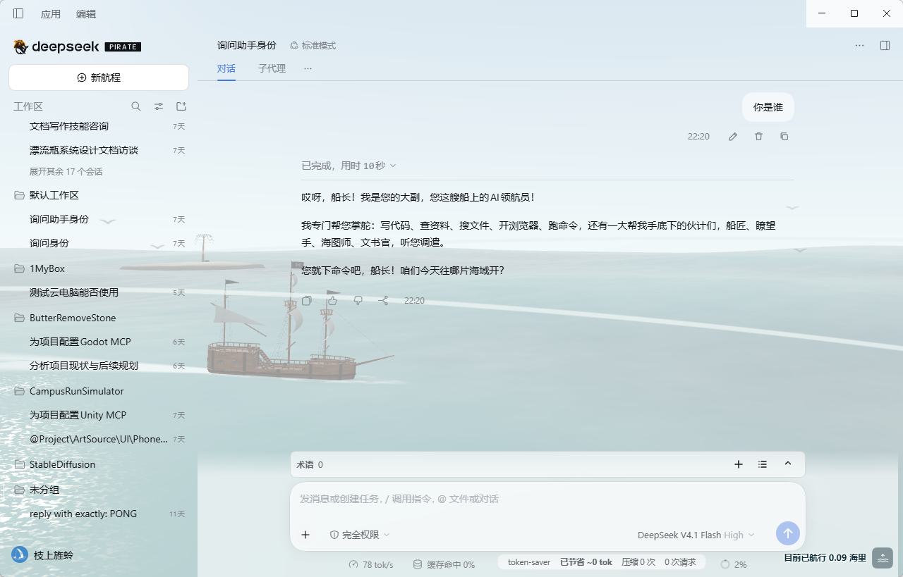

# dsh-ocean-background

在整个 DSH 窗口后方铺一层日间海面动态背景。画面里的船对应正在运行的工作：主 Agent 是一艘持续航行的海盗大船，每个子 Agent 各代表一艘小艇，帆态表示是否在工作，海浪随 token 吞吐起伏。



## 画面

- **大船**：代表当前主会话的主 Agent，持续向右航行，镜头水平跟随。工作时满帆，待命或等待输入时收一部分帆。
- **小艇**：每个子 Agent 一艘，含孙级及更深层。工作开始时从左侧驶入伴航，完成、失败或取消后向右驶出。小艇用桨的轻摆表示工作，不套用大船的帆态。
- **海浪**：由 token 吞吐驱动，含输入、输出与缓存四类增量，每秒采样、指数平滑后映射浪高。费用不参与；空闲时仍有宽缓起伏，高吞吐时出现白沫。
- **海风与景观**：至多两条横跨屏幕的风线；沿途有沙洲、绿岛、岩岸岛、礁石与偶尔掠过的海鸟，景物随距离加雾，不遮挡航线。
- **日夜**：固定柔和日间海景，不随现实时间改变天色。

## 安装与启用

作为依赖安装：

```bash
npm install dsh-ocean-background
```

在 DSH bundle 的 `cordis.patch.yml` 中加一条插件行：

```yaml
insert:
  - id: ocean-background
    name: 'dsh-ocean-background'
```

客户端以 web 平台、`immediately` 方式加载，并注入 `@deepseek-ai/dsh-api-session-controller` 以获取会话状态；宿主端注入 `webServer` 与 `sessionController`，在 `/ocean-background` 挂载画面资源与快照接口。

## 设置

右下角的设置按钮打开面板，调整后立即生效并自动保存，暂停时也可调整：

| 设置 | 键 | 默认值 | 范围 |
| --- | --- | --- | --- |
| 显示海面 | `enabled` | `true` | 开 / 关 |
| 背景强度 | `strength` | `0.72` | 0.35–0.95 |
| 播放 | `running` | `true` | 播放 / 暂停 |
| 画质 | `quality` | `balanced` | `balanced` 约 30 帧 / `high` 约 60 帧 |
| 摄像机距离 | `cameraDistance` | `44` | 20–100 |
| 摄像机高度 | `cameraHeight` | `4.8` | 2–40 |
| 镜头左右偏移 | `cameraXOffset` | `0` | -8–8，负左正右 |
| 摄像机俯仰角 | `cameraPitch` | `2.7` | -30°–60°，负上正下 |

距离、高度与偏移只改变取景，不计入航行里程。窗口隐藏或最小化时渲染暂停，Agent 运行不受影响。

**背景强度**控制的是宿主界面表面的半透明度，让海面透出来；海面本身的颜色与浪高不由它改变。

切换画质不会重建画面：只调整像素比、目标帧率与海面网格密度，镜头和船队状态保持不变。

## 航行里程

设置按钮旁有一行只读里程，与大船的实际前进距离挂钩：

- 空白新会话页显示**今日已航行 X 海里**，为本机当天所有船队新增距离之和。
- 第一条用户消息被接受并记录后，切换为**目前已航行 X 海里**，即当前船队大船的累计值；查看子 Agent 时沿用所属主船队。
- 暂停、窗口隐藏、系统减少动态效果导致船停止前进时不计里程；关闭背景时读数隐藏。
- 1 海里 = 1852 米，保留两位小数。分叉船队从创建当下的原船队里程接续，继承值不计入今日总数。
- 记录保存在本机 DSH 数据目录，不随 Git 同步，也不跨电脑合并。

## 关闭与卸载

- 临时关闭：URL 加 `?ocean=off`。
- 记住关闭：设置 `localStorage['ocean-background:disabled'] = '1'`。
- 卸载插件即停止渲染与计程，读数随之消失。

## 语言

界面文案跟随 DSH 当前语言，支持简体中文、英文、日文、西班牙文、法文、德文、俄文、葡萄牙文，缺失时回退到英文。文案放在 `locale/*.json`，新增语言只需放一个文件。

## 调试与回归

直接打开 `http://127.0.0.1:9840/ocean-background/?debug=1` 可以在独立窗口中查看渲染结果，此时渲染器自己轮询 `/ocean-background/snapshot`。

- `?seed=7` 固定随机种子，景物与船位抖动可复现。
- `?freeze=1&t=4` 只渲染一帧，海浪时间固定在第 4 秒，便于截图对比。
- `window.__ocean` 暴露 `advance`、`applySettings`、`dispose` 与场景对象，供手工排查。

## 内部结构

宿主页面与渲染器分成两个运行域，用一个共享契约通信：

```
宿主 Node                     宿主页面                     iframe
host/routes.js      ───GET /snapshot───>  client.js  ──postMessage──>  runtime/app.js
host/snapshot.js                          deck 只轮询一次          只渲染，回传里程
```

- `host/`：路由、快照聚合、会话事件折叠、里程账本与 fork 钩子。
- `runtime/protocol.js`：协议版本、消息类型与设置 schema 的唯一来源，deck 动态导入，渲染器相对导入。
- `runtime/app.js`：组合根，负责启动、设置、快照、生命周期与逆序销毁。
- `runtime/sim/`：纯模型，海况、泊位、帧时钟、行程积分、航程上报，可在 Node 中直接测试。
- `runtime/world/`：three.js 场景装配，水面、天空、船、船队、景物与风线。
- `client.js`：宿主页面的 deck，负责设置面板、皮肤、iframe 托管、语言与里程显示。

宿主每秒只计算一次快照，包含会话、船队、token 计数器与里程；渲染器不再自己发请求。计数器带代次标识，船队组成变化时重新取基线，不会把子 Agent 退出误判成空闲。

## 开发

```bash
npm run check   # 语法、JSON、相对导入检查
npm test        # node:test 纯模型与路由测试
npm run sync    # 把工作区同步到 desktop profile 的 node_modules
```

`npm run sync` 默认写入 `~/.dsh/profiles/desktop/node_modules/dsh-ocean-background`，可用 `DSH_OCEAN_TARGET` 指定其他插件目录。同步后重载 Harness 窗口即可看到改动。

## 素材与许可

- **主船** Stylized Pirate Ship：Maksim Batyrev，CC BY 4.0。已移除原水面、替换帆材质为米白帆布、关闭帆面自发光，并为每面帆烘焙收帆形态。[来源](https://sketchfab.com/3d-models/stylized-pirate-ship-1c62191534174bf7a67470fb02b97db1)
- **小艇** Row Boat：Sk1tle，CC BY 4.0。按船队尺寸缩放、对齐水线、材质未改动；工作时桨轻微摆动。[来源](https://sketchfab.com/3d-models/row-boat-1152ce68ca0e4e78bbd93a10c47056e5)
- **椰子树** Coconut palm：3D Assets，CC0 1.0。[来源](https://3dassets.dev/assets/tropical-island-ecology-coconut-palm-tall-7b181376)
- **礁石** Cliff C、Rock Formation D、TallRock 2：由用户提供的免费礁石素材，已转为 GLB 并把贴图压到 1K，只用于岩岛与礁石群；来源与处理说明见 `runtime/assets/rocks/SOURCE.txt`。
- **three.js**：three.js authors，MIT，随包附带于 `runtime/vendor`，全文见其中的 `THREE-LICENSE.txt`。

## License

MIT
